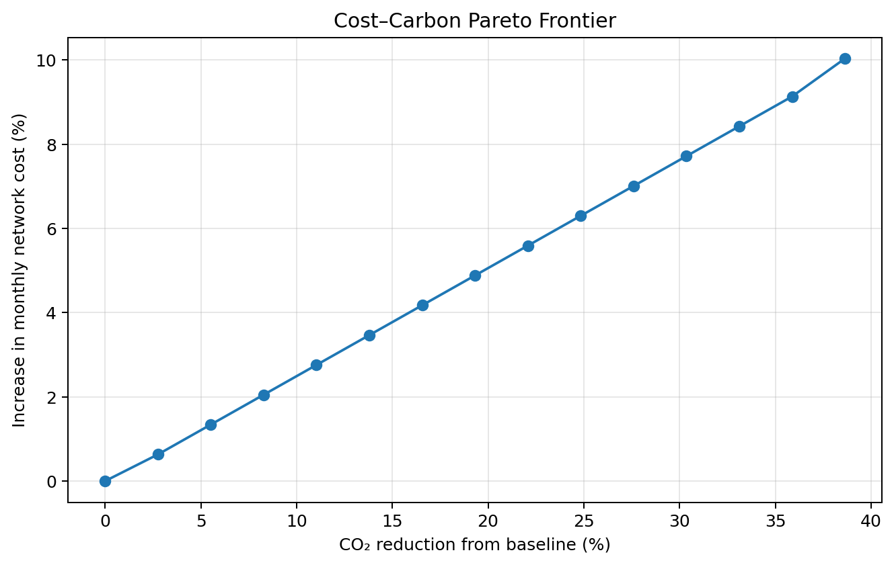
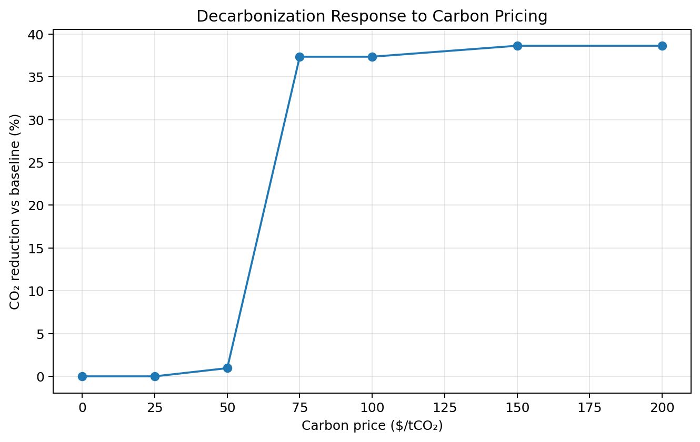
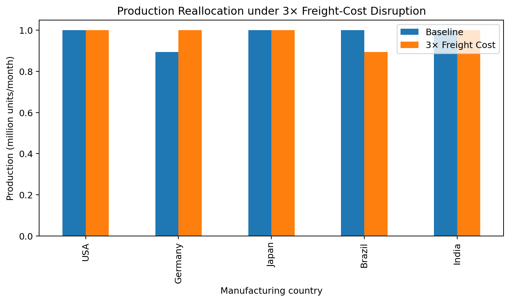

# Sustainable Multi-Objective Supply Chain Network Optimisation

**A reproducible mixed-integer linear programming (MILP) framework for cost–carbon optimisation, network design, and supply-chain stress testing.**

## Overview

This project investigates the design and operation of a stylised five-country supply-chain network spanning the **USA, Germany, Japan, Brazil, and India**.

Using **Python, PuLP, and the CBC MILP solver**, the framework evaluates production-capacity decisions, inter-country distribution flows, economic costs, and CO₂ emissions.

The study extends a deterministic cost-minimisation baseline through multi-objective optimisation and scenario-based analysis, examining the trade-offs between economic efficiency, environmental performance, and operational feasibility.

## Research Objectives

- Formulate a capacitated supply-chain network as a mixed-integer linear programming problem.
- Determine cost-minimising production and distribution configurations subject to demand and capacity constraints.
- Construct a cost–carbon Pareto frontier using the ε-constraint method.
- Investigate the response of optimal network configurations to carbon pricing.
- Evaluate feasibility under demand growth and delivery-time restrictions.
- Assess network sensitivity to severe freight-cost disruptions.

## Mathematical Formulation

The economic objective is represented by

\[
\min C = \sum_{i,s} F_{is}y_{is} + \sum_{i,j} c_{ij}x_{ij}
\]

where \(y_{is}\) denotes facility-capacity selection decisions and \(x_{ij}\) denotes supply flows between countries.

Network CO₂ emissions are represented by

\[
E = \sum_{i,j} e_{ij}x_{ij}.
\]

The model incorporates capacity, demand-fulfilment, and network-feasibility constraints.

For multi-objective analysis, emissions are constrained by a prescribed budget:

\[
E \leq \varepsilon.
\]

The ε-constraint approach identifies minimum-cost feasible network configurations across progressively tighter emissions budgets.

## Key Numerical Results

| Analysis | Modelled outcome |
|---|---|
| Cost–carbon optimisation | Up to 38.64% CO₂ reduction at approximately 10.04% higher monthly cost |
| Delivery-time feasibility | Minimum feasible uniform allowance of approximately 34 days |
| Demand-growth feasibility | Approximately 2.15% estimated capacity headroom under the existing candidate capacity structure |
| Freight disruption | Approximately 56.15% increase in optimal network cost under a 3× freight-cost scenario |
| Carbon pricing | First tested network response at approximately $50/tCO₂ |

These results are specific to the modelled network, input assumptions, and tested scenarios. They should not be interpreted as validated predictions for an operating commercial supply chain.

### Cost–Carbon Pareto Analysis

The ε-constraint method quantifies the economic trade-off associated with progressively reducing network emissions.



### Carbon-Price Response

Carbon-price scenarios investigate how incorporating an emissions penalty into the economic objective can influence optimal sourcing and production decisions.



### Freight-Disruption Stress Test

Freight costs are increased by a factor of three, and the deterministic network is re-optimised to evaluate changes in economic performance and production allocation.



## Repository Structure

```text
sustainable-supply-chain-optimization/
├── Code/
│   └── 01_deterministic_baseline.ipynb
├── Datasets/
│   ├── capacity.xlsx
│   ├── CO2_Emissions.xlsx
│   ├── Delivery_Deadlines.xlsx
│   ├── Delivery_LeadTime.xlsx
│   ├── demand.xlsx
│   ├── fixed_cost.xlsx
│   ├── freight_costs.xlsx
│   ├── Storage_costs.xlsx
│   └── variable_costs.xlsx
├── carbon_price_response.png
├── cost_carbon_pareto.png
├── freight_disruption.png
├── README.md
├── requirements.txt
├── .gitignore
└── LICENSE
```

The repository contains nine Excel input workbooks. The consolidated `Total_Data.xlsx` workbook is retained locally and is not required by the current notebook.

## Installation and Reproduction

**1. Clone the repository**

```bash
git clone https://github.com/mtryptnkr-study/sustainable-supply-chain-optimization.git
cd sustainable-supply-chain-optimization
```

**2. Install dependencies**

```bash
python -m pip install -r requirements.txt
```

**3. Launch Jupyter from the `Code` directory**

```bash
cd Code
jupyter notebook 01_deterministic_baseline.ipynb
```

The notebook uses relative paths of the form `../Datasets/filename.xlsx`. Launching Jupyter from the `Code` directory ensures that these paths resolve correctly.

The model requires a working PuLP-compatible MILP solver, such as CBC.

## Methods and Tools

**Mathematical optimisation:** MILP, ε-constraint method, Pareto analysis, constrained network optimisation.

**Computational tools:** Python, PuLP, CBC, NumPy, Pandas, Matplotlib, OpenPyXL, Jupyter Notebook.

**Scenario investigations:** Carbon pricing, demand-growth feasibility, delivery-time feasibility, and freight-cost disruption.

## Assumptions and Limitations

The framework represents a **deterministic, stylised supply-chain network** rather than an experimentally validated industrial system.

Current limitations include:

- No probabilistic modelling of demand uncertainty.
- No multi-period inventory dynamics.
- No explicit supplier-failure probability model.
- No endogenous selection of transport modes.
- No nonlinear economies of scale.
- No uncertainty distributions for CO₂-emission factors.

Demand and freight-cost investigations are deterministic scenario analyses. They should not be interpreted as formal robust or stochastic optimisation.

The model's delivery-deadline inputs and capacity assumptions require careful interpretation when extending the framework to more realistic operating conditions.

## Future Research Directions

Potential extensions include:

- Stochastic programming for uncertain demand and logistics costs.
- Robust optimisation under bounded parameter uncertainty.
- Monte Carlo scenario analysis.
- Sensitivity analysis and systematic uncertainty quantification.
- Multi-period production and inventory optimisation.

These are proposed extensions and are not part of the completed deterministic baseline.

## Author

**Maitrey Patankar**  
M.Tech Sustainable Engineering  
Indian Institute of Technology Hyderabad